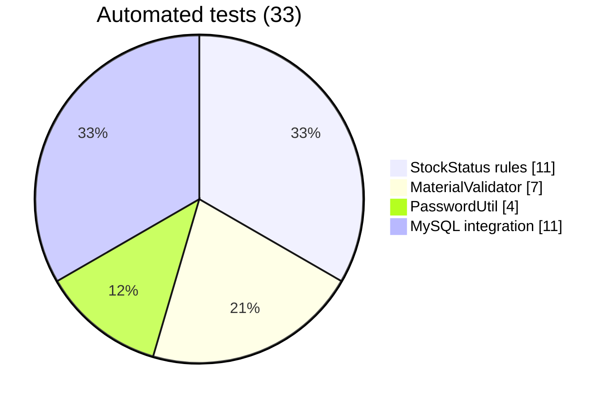
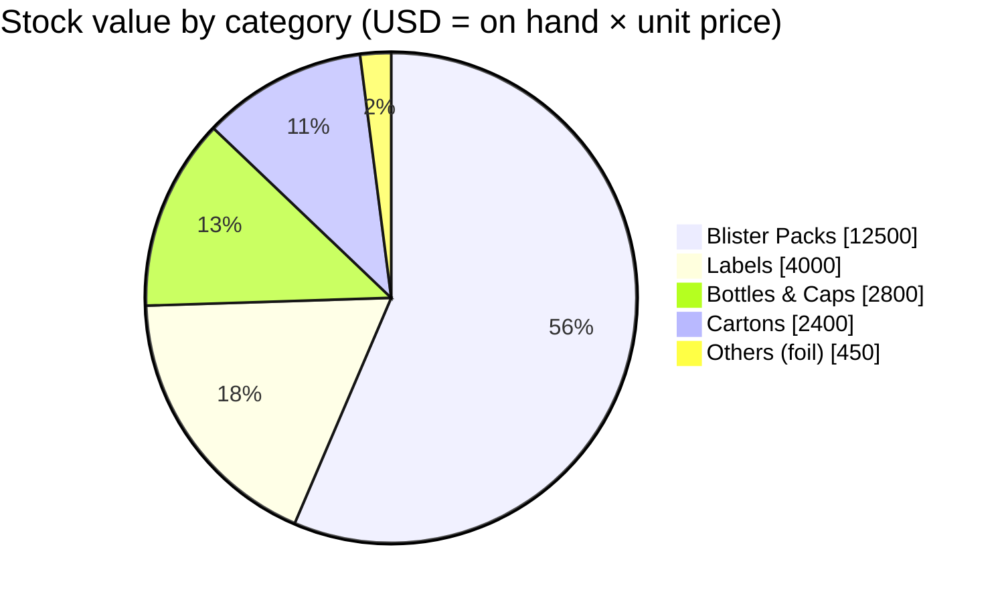
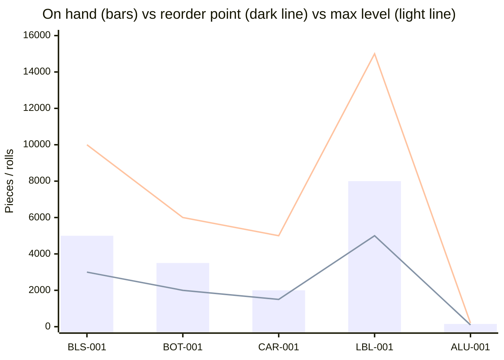
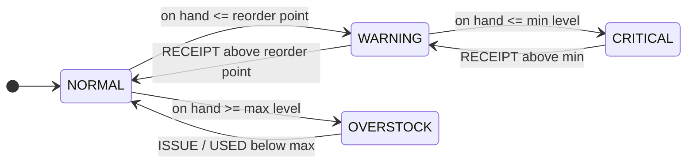
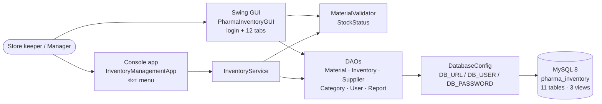
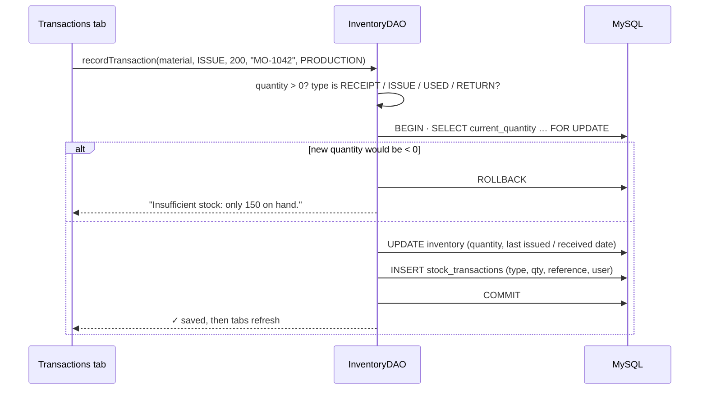
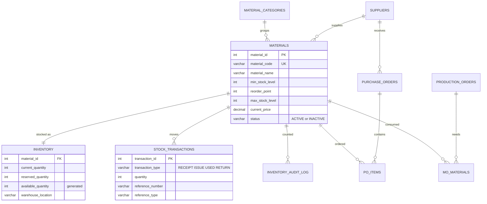
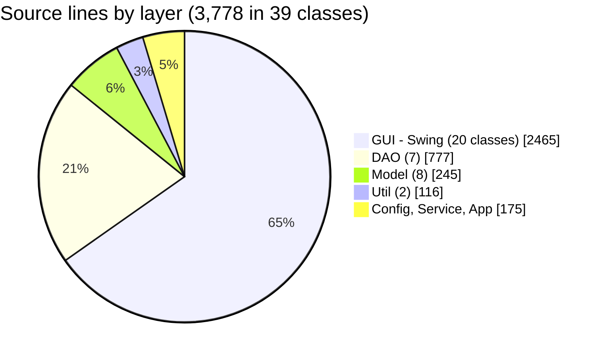

<div align="center">

# 📦 Pharmaceutical Packaging Inventory Management

### Java Swing + console app on MySQL for packaging materials (blister film, bottles, cartons, labels, foil): stock levels, receipts and issues, low-stock alerts and reports

[](https://git.io/typing-svg)

<!-- ============ STATUS BAR ============ -->
[](https://github.com/rbchy/InventoryControlManagement_JavaMySql/actions/workflows/ci.yml)


</div>

---

## 📌 At a Glance

<table>
<tr>
<td width="50%" valign="top">

**🙋 What this is**

An inventory system for the **packaging materials** of a pharmaceutical packaging line. It is built from the way a GMP packaging floor actually handles material:

- every material has a **min level, a reorder point and a max level**;
- every stock movement is a **RECEIPT, ISSUE, USED** (consumed in a batch) **or RETURN**, with a batch or PO reference;
- each movement is recorded in **one database transaction** together with the stock change, so stock can never go below zero.

It has two front ends on the same MySQL database: a **Swing desktop app** with 12 tabs, and a **Bangla console menu**.

On every push, GitHub Actions loads the schema into **MySQL 8**, runs the unit and database tests, drives the console menu, and opens the GUI under a virtual display.

</td>
<td width="50%" valign="top">

**📍 Quick facts**

| | |
|---|---|
| 🖥️ **GUI** | Swing, login / register + 12 tabs |
| ⌨️ **Console** | বাংলা menu: dashboard, transactions, suppliers |
| 💾 **Database** | MySQL 8 · 11 tables · 3 views |
| 🧪 **Tests** | 22 unit · 11 MySQL integration |
| ✅ **CI** | 33 / 33 + console + GUI · ≈ 1.5 min |
| 🔐 **Login** | Salted SHA-256, no credentials in code |
| 📚 **Docs** | Bangla guides in [`docs/guides`](docs/guides) |

</td>
</tr>
</table>

---

## ✅ Latest Results

| Suite | Runs against | Result |
|---|---|---|
| `StockStatusTest` | CRITICAL / WARNING / NORMAL / OVERSTOCK at every boundary, plus the sample data | ✅ 11 / 11 |
| `MaterialValidatorTest` | required fields, price ≥ 0, max > min, min ≤ reorder ≤ max, lead time | ✅ 7 / 7 |
| `PasswordUtilTest` | salt:hash format, unique salts, the three demo logins, plaintext never matches | ✅ 4 / 4 |
| `InventoryDatabaseIT` (MySQL 8) | logins and registration, RECEIPT / ISSUE / USED / RETURN, rollback when stock is short, bad movements refused, add → alert → soft delete, **Java status = SQL view status for every material**, every report, inclusive date filter | ✅ 11 / 11 |
| Console check | menu `1 → 5 → 6 → 0` prints the dashboard, transactions and suppliers with no errors | ✅ |
| GUI launch check | `java -jar target/pharma-inventory.jar` is still running after 20 s under Xvfb | ✅ |



---

## 📊 Sample Data at a Glance

`docs/01_database_schema.sql` ships with 5 materials, 5 categories, 3 suppliers and 3 users.





| Code | Material | On hand | Reserved | Available | Min | Reorder | Max | Status |
|---|---|--:|--:|--:|--:|--:|--:|:--:|
| BLS-001 | Blister Pack PVC 10 cavity | 5,000 | 500 | 4,500 | 1,000 | 3,000 | 10,000 | 🟢 NORMAL |
| BOT-001 | Bottle 20 ml HDPE | 3,500 | 200 | 3,300 | 800 | 2,000 | 6,000 | 🟢 NORMAL |
| CAR-001 | Carton Box 100×100 mm | 2,000 | 100 | 1,900 | 500 | 1,500 | 5,000 | 🟢 NORMAL |
| LBL-001 | Label Printed 50×30 mm | 8,000 | 1,000 | 7,000 | 2,000 | 5,000 | 15,000 | 🟢 NORMAL |
| ALU-001 | Aluminium Foil Strip 500 m | 150 | 20 | 130 | 50 | 100 | 200 | 🟢 NORMAL |

---

## 🚦 How Stock Status Works

There is one rule, `model/StockStatus.java`. The `inventory_summary` view uses the same rule as a SQL `CASE`, and a test checks that the two agree for every material.



| Status | Rule (checked in this order) | What to do |
|---|---|---|
| 🔴 **CRITICAL** | on hand ≤ min level | Reorder urgently, and check whether the line can run |
| 🟠 **WARNING** | on hand ≤ reorder point | Raise a purchase order (shows in **Low Stock Alerts**) |
| 🟡 **OVERSTOCK** | on hand ≥ max level | Stop ordering and check warehouse space |
| 🟢 **NORMAL** | otherwise | — |

---

## 🏗️ Architecture



### 🔄 Recording a stock movement (one transaction)



### 🗄️ Database



Views:
- `low_stock_items`: active materials at or below their reorder point
- `inventory_summary`: stock value and status for active materials
- `recent_transactions`: the last 100 movements

`users` stands alone. Purchase-order, audit and production-order tables are in the schema for the roadmap; no screen uses them yet.

---

## ✨ Features

| Tab / menu | What it does |
|---|---|
| 🔐 **Login / Register** | Salted SHA-256 passwords. Self-registration is limited to OPERATOR and MANAGER. The error message is generic, so usernames cannot be probed. |
| 🏠 **Welcome** | Dashboard cards: active materials, suppliers, number of items that need reordering |
| ➕ **Add / ✏️ Update Material** | Code, name, category, supplier, unit, price, min / reorder / max, lead time, opening stock, warehouse location. Every value is validated before it is saved. |
| 📋 **View / 🔍 Search / 🗑️ Delete** | Table of active materials. Search by code or name (`_` and `%` are matched literally). **Soft delete**: the material is marked INACTIVE, so its history stays. |
| 🔄 **Transactions** | Record a RECEIPT, ISSUE, USED or RETURN with a batch / PO reference, and see recent movements |
| ⚠️ **Low Stock Alerts** | Active materials at or below their reorder point, with the quantity to order to reach max, and the supplier |
| 📊 **Reports** | Inventory In / Out / Used / Return with a date range, Stock Update, Min Level and Max Level breaches |
| 🏢 **Suppliers** · ❓ **Help** · ♻️ **Refresh** | Supplier list, built-in help on the status colours, reload of every tab |
| ⌨️ **Console** | `1` dashboard · `5` transactions · `6` suppliers · `0` exit, in Bangla |



---

## 🛠️ Tech Stack

| Layer | Technology |
|---|---|
| Language | Java 11+ (CI builds on 17) |
| UI | Swing (custom theme, background banner, tabbed layout) and a console menu |
| Data access | JDBC with `PreparedStatement`, `SELECT … FOR UPDATE` for stock movements |
| Database | MySQL 8: generated `available_quantity` column, 3 views |
| Build | Maven (keeps the Eclipse `src/` layout), shaded runnable jar with the MySQL driver |
| Tests | JUnit 5 (Surefire), Failsafe for `*IT` against MySQL |
| CI | GitHub Actions: MySQL 8 service, `mvn verify`, scripted console run, Xvfb GUI launch, jar and reports as artifacts |

---

## ⚙️ Getting Started

**You need:** JDK 11 or newer, MySQL 8, and Maven 3.8+ (or use the `run_*.sh` scripts and the driver in `lib/`).

```bash
# 1. Database: drops and recreates every table in pharma_inventory, then loads sample data
mysql -u root -p --default-character-set=utf8mb4 < docs/01_database_schema.sql

# 2. Credentials (never written in the code; see .env.example)
export DB_URL="jdbc:mysql://localhost:3306/pharma_inventory?useSSL=false&allowPublicKeyRetrieval=true"
export DB_USER=root DB_PASSWORD='your-password'

# 3a. Build, test, run the GUI
mvn verify                                   # database tests run too when DB_URL is set
java -jar target/pharma-inventory.jar

# 3b. ...or without Maven
./run_gui.sh          # Swing GUI
./run_console.sh      # console menu
```

**From Eclipse:** import as an existing project, then use the `PharmaInventoryGUI` or `InventoryManagementApp` launch configuration. Set `DB_PASSWORD` under *Run Configurations → Environment*.

**Demo logins:**

| User | Password | Role |
|---|---|---|
| `admin` | `admin123` | ADMIN |
| `inventory_mgr` | `pass123` | MANAGER |
| `store_keeper` | `store123` | OPERATOR |

---

## 📁 Project Structure

```text
InventoryControlManagement_JavaMySql/
├── .github/workflows/ci.yml          # MySQL 8 → mvn verify → console run → GUI launch
├── src/com/pharma/inventory/
│   ├── app/       InventoryManagementApp      (console)
│   ├── gui/       PharmaInventoryGUI + 12 tabs, login / register, theme
│   ├── service/   InventoryService
│   ├── dao/       Material · Inventory · Supplier · Category · User · Report DAOs
│   ├── model/     Material · Inventory · StockStatus · Supplier · StockTransaction · …
│   ├── util/      PasswordUtil · MaterialValidator
│   └── config/    DatabaseConfig (env vars / -D properties)
├── test/com/pharma/inventory/        # unit tests + InventoryDatabaseIT
├── docs/
│   ├── 01_database_schema.sql        # 11 tables, 3 views, sample data
│   └── guides/                       # original Bangla README, step-by-step guide, examples
├── resources/images/                 # optional GUI banner
├── lib/mysql-connector-j-9.7.0.jar   # driver for Eclipse / run_*.sh
├── run_gui.sh · run_console.sh · *.launch · .env.example
└── pom.xml
```

---

## 🧹 Maintenance Log

The README was checked against the code, and these issues were fixed:

| Issue found | Fix |
|---|---|
| ❌ **The repository had only a README.** No source, no schema. | Added the GUI and console source, schema, run scripts, launch configs and Bangla guides from the author's Eclipse workspace |
| 🚦 **Two different stock-status rules.** At exactly min or max, the console said NORMAL while the GUI and reports said CRITICAL / OVERSTOCK. | One `StockStatus` rule. A test compares it with the SQL view for every material. |
| 🧾 **No validation on materials.** A negative price, max ≤ min, or a reorder point outside min..max were all saved. The Add form's 0 / 0 / 0 defaults gave a permanently OVERSTOCK material. | Added `MaterialValidator`, enforced in `MaterialDAO` on add and update |
| ➖ **Unknown transaction types removed stock.** Anything other than RECEIPT / RETURN was treated as an issue. | Only RECEIPT / ISSUE / USED / RETURN are accepted |
| 👻 **Deleted materials kept alerting.** Soft-deleted materials still appeared in Low Stock Alerts and the stock report. | The views now show ACTIVE materials only |
| 🔍 **Search used wildcards.** `_` and `%` in a search acted as SQL wildcards. | They are escaped |
| 🚀 **The Eclipse configuration was wrong.** `PharmaInventoryGUI.launch` started **another project** (Bhojan-Aloy), and `.classpath` pointed the source root at `src/com`. | Both fixed |
| 📝 **The README described things that don't exist:** purchase-order management, role-based access, connection pooling, "manual testing", and a `config/DatabaseConfig.java` password to edit. | Rewritten to match the code. Credentials come from env vars. Purchase orders and roles are on the roadmap. |
| 🧪 No build file, no tests, no CI | Added a Maven build, 33 tests, console and GUI checks, and GitHub Actions |

---

## 📈 Roadmap

- [ ] Purchase-order screens (`purchase_orders` / `po_items` tables already exist)
- [ ] Role-based tabs: ADMIN / MANAGER / OPERATOR currently see the same screens
- [ ] Block issuing **reserved** stock (today only on-hand may not go below 0)
- [ ] Physical count screen using `inventory_audit_log`, with variance %
- [ ] Production orders → automatic USED / RETURN per batch (`production_orders`, `mo_materials`)
- [ ] Charts in the Welcome tab (stock value by category, status mix)
- [ ] Save a new material and its opening stock in one transaction

---

## 🔗 Related Projects

| Project | Stack |
|---|---|
| 💊 [PPES — Pharmaceutical Packaging Management](https://github.com/rbchy/PPES-Pharmaceutical-Packaging-Management) | Java Swing · MySQL · 49 / 49 in CI |
| 🧮 [Pharmaceutical Production Management Calculator](https://github.com/rbchy/RbcTcsWorld_Pharmaceuticals_PMC) | Spring Boot · MySQL · 81 / 81 in CI |
| 💊 [PharmaPack QMS](https://github.com/rbchy/RbcTcsWorld_PharmaPackQMS) | Spring Boot QMS: AQL, deviations, CAPA, reconciliation · 66 / 66 in CI |
| ☕ [Bhojanaloy POS](https://github.com/rbchy/BhojanAloy-Food-Coffee-Shop-POS-System) | Java Swing + Spring Boot · MySQL · 76 / 76 in CI |

<sub>All projects: [github.com/rbchy](https://github.com/rbchy)</sub>

---

## ⚠️ Disclaimer

This is a **portfolio / training project** built from hands-on GMP packaging experience. It is **not** a validated GxP system. Stock levels and material handling must follow your site's SOPs.

---

## 👤 Author

<div align="center">

**Ranajit Baran Chowdhury (RB Chowdhury)**
QA Automation Engineer / SDET · Pharmaceutical Packaging Production (GMP) · West Norriton, Pennsylvania, USA

[](https://www.linkedin.com/in/rbchy/)
[](https://github.com/rbchy)
[](https://rbchy.github.io/rbchy/)
[](https://rbc6543.wixsite.com/rbc-portfolio)
[](mailto:chyranajit@gmail.com)

<sub>MIT licensed — see [LICENSE](LICENSE).</sub>

⭐ *If this project helps you, a star on the repo is appreciated.*

</div>
